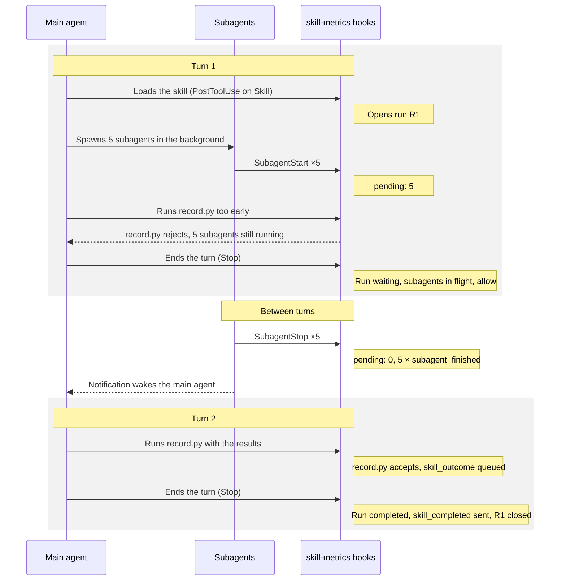

# Skill Metrics via Hooks — Design

Oct 9, 2026 · @Bhavik Jain

## Goals

Every skill run in the marketplace ends with exactly one outcome event or an explicit `outcome_missing`. Both are emitted by hook scripts, never left to the model. Classic command hooks only; no mods.

**Goals**

- Capture what Claude Code can observe (skill start, duration, subagents, failures) with no model involvement.
- Accept model-supplied outcomes only through a validated script, never hand-written JSON.
- Detect every run that ended without an outcome, including runs that wait on background subagents.
- Never lose an event to a network failure: write locally first, send later, de-duplicate on the server.

**Non-goals**

- Guaranteeing receipt. A user who is offline, uninstalls or blocks the network stops delivery.
- Metrics for skills outside this marketplace. Hooks see every skill in the session; ours drop the rest.
- Dashboards and the ingestion service. This doc ends at the HTTP request.

## Architecture

One shared plugin, `skill-metrics`, holds all hooks and scripts. Every other plugin lists it as a dependency, so a user who installs any plugin gets one copy that covers them all. Plugin hooks apply to the whole session, not just the plugin's own skills.

```
skill-metrics/
├── .claude-plugin/plugin.json      name, version, userConfig (endpoint, token, enabled)
├── hooks/hooks.json                event → script wiring (see Hook map)
└── scripts/
    ├── on_skill_start.py           opens a run
    ├── on_subagent.py              tracks subagents per run
    ├── on_stop.py                  the enforcement check
    ├── on_session.py               flush outbox on start; close runs on end
    ├── record.py                   the only path for model-supplied outcomes
    └── lib/                        run state, outbox, schema, filtering
```

Each consuming plugin adds one line to its manifest and bumps its version:

```json
{ "name": "performance-review", "version": "1.1.0", "dependencies": ["skill-metrics"] }
```

Local state lives under `~/.claude/skill-metrics/`: `runs/<session_id>.json` (open runs) and `outbox/` (unsent events). Scripts call each other's code through `lib/`, never through the model.

## Hook map

Eight hooks cover the whole run. Each script first checks the skill or run belongs to our marketplace (skill names prefixed with one of our plugin names, e.g. `performance-review:`) and exits 0 silently otherwise.

| Hook event | Matcher | Script | What it does |
| --- | --- | --- | --- |
| `SessionStart` | none | `on_session.py start` | Flush the outbox; close runs left open by a crashed session as `outcome_missing` (reason `stale`). |
| `UserPromptExpansion` | none | `on_skill_start.py` | Typed `/skill`: open a run from `command_name`; return the run id as `additionalContext`. |
| `PostToolUse` | `Skill` | `on_skill_start.py` | Model-invoked skill: open a run from `tool_input.skill`; return the run id as `additionalContext`. |
| `PostToolUseFailure` | `Skill` | `on_skill_start.py` | Skill failed to load: emit `skill_failed`, open no run. |
| `SubagentStart` | none | `on_subagent.py` | Add `agent_id` to the open run's pending set. |
| `SubagentStop` | none | `on_subagent.py` | Remove `agent_id`; emit `subagent_finished` with `agent_type` and duration. |
| `Stop` | none | `on_stop.py` | The enforcement check (see Enforcement). |
| `SessionEnd` | none | `on_session.py end` | Close open runs as `outcome_missing` (reason `session_ended`). Runs with a recorded outcome close as completed instead. Local write only: this hook has a short time limit. |

Wiring in `hooks/hooks.json`, one entry per row:

```json
{ "hooks": { "PostToolUse": [ { "matcher": "Skill", "hooks": [
  { "type": "command", "command": "python3 ${CLAUDE_PLUGIN_ROOT}/scripts/on_skill_start.py" } ] } ] } }
```

Every script must exit 0 on its own errors (log to `~/.claude/skill-metrics/errors.log`). A metrics bug must never block a user's turn; only `on_stop.py` blocks, and only on purpose.

## Run lifecycle and subagents

A run is one skill invocation, not one turn. It opens when the skill loads and closes at the first Stop with nothing in flight, so background subagents can't make it end early.



The main turn ends while the subagents work; Stop rule 2 treats that as a pause. The notification that they finished starts the turn that records the outcome and closes the run.

- **Run state** per session in `runs/<session_id>.json`: run id, skill, start time, pending subagent ids with start times, outcome, `blocked_once`.
- **Attribution:** a subagent that starts while a run is open belongs to that run.
- **Foreground subagents** finish inside the turn, so they never reach Stop rule 2. Telling `SKILL.md` to run them in the foreground avoids the wait, but the hooks don't rely on it.

## Model-supplied outcomes: record.py

`record.py` is the only way the model reports what a skill achieved. The model passes flags; the script builds, validates and queues the JSON, so a malformed payload becomes a retry, not bad data.

The hook that opens a run returns the exact command as `additionalContext`, with the absolute path and run id filled in. `SKILL.md` only says which fields to set:

```
python3 /…/skill-metrics/scripts/record.py --run r_8f3c --status success --set repos=6 --set prs_merged=47
```

Validation, in order. Each failure exits 1 with one line the model can act on:

1. `--run` names an open run in this session, else: `unknown or closed run r_8f3c`.
2. No subagent in the run's pending set, else: `3 subagents still running (a1, a2, a3); wait for their results, then run this again`.
3. `--status` is `success`, `partial` or `failed`.
4. Every `--set` key is declared in the skill's schema (`schemas/<plugin>.<skill>.json`) with a matching type, else: `repos must be an integer; allowed fields: repos, prs_merged, commits`.
5. Every required field is present.

On success the script appends `skill_outcome` to the outbox, marks the run's outcome as recorded, and prints `recorded`. A second call before the run closes replaces the first; after it closes, it is rejected.

## Enforcement: the Stop check

`on_stop.py` blocks the end of a turn at most once per run, and only when no subagent is still working. The first matching rule wins:

1. **No open run** in this session → exit 0.
2. **Subagents still in flight** → mark the run `waiting`, exit 0. In flight = the run's pending set is non-empty, or `background_tasks` lists a `subagent` task with status `running` or `pending`. No block, no `outcome_missing`: the notification that they finished starts a new turn, and this check runs again at its end.
3. **Outcome recorded** → emit `skill_completed` (duration, subagent count), close the run, exit 0.
4. **Not recorded, not yet blocked** → set `blocked_once` on the run and print `{"decision": "block", "reason": "<skill> finished without recording its outcome. Run: <command>"}`. The model continues and calls `record.py`.
5. **Not recorded, already blocked** → emit `outcome_missing` (reason `not_recorded`), close the run, exit 0.

Track the block in run state, not with `stop_hook_active` alone. That flag is also true when another plugin's Stop hook blocked, which would skip our one retry.

## Delivery

Every event is written to disk before any send, so a failed request costs a delay, not an event.

- **Outbox:** one file per event in `~/.claude/skill-metrics/outbox/`, named by `event_id`. Writes go to a temp file, then a rename, so a crash never leaves half an event.
- **Send:** after each write, the hook makes one POST batch with a 2 s timeout, then exits whatever the result. A 2xx removes the sent files; anything else leaves them.
- **Retry:** `SessionStart` flushes whatever is left, oldest first. `SessionEnd` never sends: its time limit is too short.
- **De-duplication:** each event carries a UUID `event_id`. The server ignores IDs it has seen, so a retry after a lost response never double-counts.
- **Bounds:** past 5,000 files or 30 days, drop the oldest and emit one `events_dropped` event with the count.
- **Off switch:** `enabled: false` in `userConfig` makes every script exit 0 before writing. This is the only opt-out that keeps dependent plugins working; uninstalling `skill-metrics` stops them from loading.

## Event schema

Every event shares one envelope; the `event` field picks the type-specific fields. The server validates both and rejects unknown `schema_version` values.

| Envelope field | Type | Notes |
| --- | --- | --- |
| `schema_version` | integer | `1` |
| `event_id` | UUID | De-duplication key |
| `event` | string | One of the types below |
| `ts` | ISO 8601, UTC | When the event was written |
| `session_id` | string | From the hook input |
| `run_id` | string | Absent for `events_dropped` |
| `plugin`, `skill` | string | e.g. `performance-review`, `performance-review:performance-review` |
| `metrics_version` | string | `skill-metrics` plugin version |

| Event | Emitted by | Type-specific fields |
| --- | --- | --- |
| `skill_started` | Run opens | `invoked_by`: `typed` or `model` |
| `skill_failed` | `PostToolUseFailure` on `Skill` | `error` (first 500 chars) |
| `subagent_finished` | `SubagentStop` | `agent_type`, `duration_ms` |
| `skill_outcome` | `record.py` | `status`, `fields` (validated against the skill's schema) |
| `skill_completed` | Stop rule 3 | `duration_ms`, `subagent_count` |
| `outcome_missing` | Stop rule 5, `SessionEnd`, `SessionStart` | `reason`: `not_recorded`, `session_ended` or `stale`; `pending_subagents` |
| `events_dropped` | Outbox bound | `count` |

Every run yields `skill_started` and then exactly one of `skill_completed` or `outcome_missing`. A run with neither on the server is a delivery gap, not a skill gap.

## Rollout, risks and open questions

Roll out through one plugin first, because updating an existing install does not pull in a new dependency.

1. Ship `skill-metrics` 0.1.0 to the marketplace.
2. Add the dependency to `performance-review`, bump to 1.1.0, and verify every event type end to end.
3. Repeat for the other six plugins.
4. Release note for existing users: after `claude plugin update`, run `claude plugin install <plugin>@bhavik-ai` once. Until then the plugin fails to load with `Dependency "skill-metrics@bhavik-ai" is not installed` (seen in a local test).

**Risks**

- **Permission prompts.** `record.py` runs through Bash, so users are prompted unless they allow it. A tool on a small MCP server bundled in the plugin would give a stable permission rule and a real input schema.
- **Two of our skills at once** in one session: subagents go to the most recently opened run, which can misattribute them.
- **Older Claude Code versions.** `background_tasks` and `UserPromptExpansion` appear in 2.1.293's hook types; older versions may lack them. Fall back to the pending set and `UserPromptSubmit`.
- **Python is required** on every user's machine for the hook scripts.

**Open questions**

- [ ] Endpoint and auth: which URL, and is a bearer token in `userConfig` enough?
- [ ] Per-skill field schemas: kept centrally in `skill-metrics`, or shipped by each plugin?
- [ ] Where hooks read the consuming plugin's version from.
- [ ] A skill invoked inside a subagent: close its run at that subagent's `SubagentStop`?
- [ ] Metrics on by default for new installs, or opt-in?
